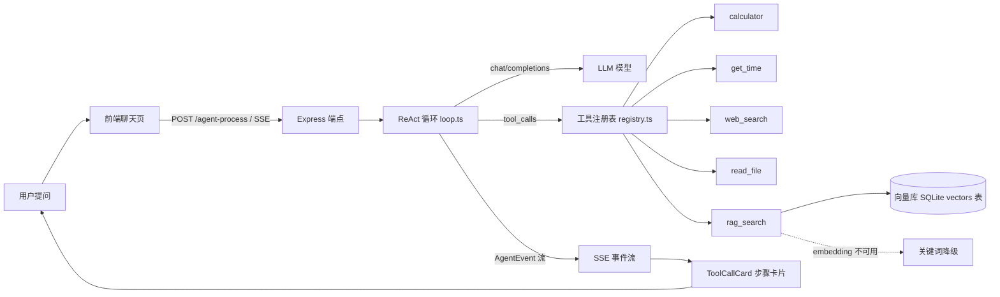

# 思脉AI工作台 · pulse · agent console

> 一个可调用工具的 Agent 化 AI 对话工作台 —— 用 **ReAct 工具调用循环、RAG 知识库与 SSE 流式交互**，把普通聊天升级成能拆解任务、逐步执行的 Agent 控制台。

[](https://nodejs.org)
[](https://www.typescriptlang.org)
[](https://vuejs.org)
[](https://expressjs.com)

---

## 目录

- [项目简介](#项目简介)
- [Agent 架构](#agent-架构)
- [ReAct 循环说明](#react-循环说明)
- [工具系统](#工具系统)
- [RAG 知识库](#rag-知识库)
- [技术亮点](#技术亮点)
- [快速开始](#快速开始)
- [部署（Docker）](#部署docker)
- [配置说明](#配置说明)
- [来源与许可](#来源与许可)

## 项目简介

「思脉AI工作台」是一个 **Agent 化**的 AI 对话应用：在普通聊天的基础上，模型可以按需调用工具（计算器、时间、联网搜索、文件读取、知识库检索），像"思考 → 行动 → 观察 → 总结"的人类工作流一样拆解并完成任务。


- **前端**：Vue 3 + Naive UI + Tailwind，支持多语言、暗色模式、PWA、命令面板（⌘K）
- **后端**：Express + TypeScript，OpenAI 兼容协议，零外部服务依赖即可跑通全流程
- **Agent 内核**：自研 ReAct 循环 + 工具注册表 + 熔断/预算兜底，约 400 行核心代码

## Agent 架构



**数据流**：前端开启 Agent 模式 → `/agent-process` 建立 SSE 长连接 → 后端运行 ReAct 循环 → 每产生一个事件（思考/工具调用/工具结果/回答）立即推给前端 → 前端以控制台步骤流卡片实时渲染。

## ReAct 循环说明

ReAct（Reasoning + Acting）让模型交替进行「推理」与「工具调用」，直到得出最终答案：

```
┌─────────────────────────────────────────────┐
│ while (未达到步数/预算上限) {                 │
│   1. 调用模型（携带对话历史 + 工具列表）       │
│   2. 模型返回：有 tool_calls 还是直接回答？    │
│      ├─ 直接回答 → 推送 answer 事件，结束     │
│      └─ 有 tool_calls →                       │
│          a. 推送 thought 事件（模型思考）      │
│          b. 逐个执行工具，推送 tool_call/      │
│             tool_result 事件                  │
│          c. 把工具结果回填为 role:'tool' 消息   │
│          d. 继续下一轮（模型可基于结果自愈）    │
│   3. 熔断检查：步数或 token 预算超限时注入     │
│      系统消息要求模型立即总结收尾（仅一次）     │
│ }                                            │
└─────────────────────────────────────────────┘
```

关键设计：

- **自愈**：工具抛错不会中断循环，错误文本以 `[tool error]` 回填，模型可据此纠正参数重试
- **熔断**：达到 `AGENT_MAX_STEPS` 或 token 预算时注入收尾指令，模型仍不停止则强制截断，防止死循环
- **兜底说明**：熔断后回答自动附带「（因预算/步数限制提前截断）」标注

## 工具系统

每个工具是一个独立文件，实现统一的 `Tool` 接口后注册即可：

| 工具 | 文件 | 能力 |
|------|------|------|
| calculator | `service/src/tools/calculator.ts` | 安全四则运算（自研递归下降解析，**禁 eval**） |
| get_time | `service/src/tools/getTime.ts` | 当前时间 / IANA 时区换算（零依赖） |
| web_search | `service/src/tools/webSearch.ts` | 联网搜索（DeepSeek Search API，复用 `API_KEY`，无 key 时降级提示） |
| read_file | `service/src/tools/readFile.ts` | 只读仓库内文件（白名单 + 100KB 上限） |
| rag_search | `service/src/tools/ragSearch.ts` | 知识库语义检索（embedding 不可用时关键词降级） |

### 如何扩展一个新工具

1. 在 `service/src/tools/` 新建 `myTool.ts`：

```ts
import type { Tool } from '../agent/types'

export const myTool: Tool = {
  name: 'my_tool',
  description: '描述这个工具的用途（会被模型看到，务必写清楚参数含义）',
  parameters: {
    type: 'object',
    properties: {
      keyword: { type: 'string', description: '参数说明' },
    },
    required: ['keyword'],
  },
  // 参数是 Record<string, unknown>，返回 string（或 Promise<string>）
  handler: async (args) => {
    return `处理结果：${String(args.keyword)}`
  },
}
```

2. 在 `service/src/tools/index.ts` 注册：

```ts
import { myTool } from './myTool'
register(myTool)
```

3. 跑单测（建议为每个工具写 vitest 用例）：`cd service && pnpm vitest run`

## RAG 知识库

- **切块**：markdown/txt 按标题与段落切分，500 字窗口 + 50 字重叠（`rag/chunk.ts`）
- **向量化**：OpenAI 兼容 embeddings 接口，支持独立服务商配置（`EMBEDDING_API_BASE_URL` / `EMBEDDING_API_KEY`）
- **存储**：余弦相似度检索；向量持久化在 `service/data/agent.db` 的 `vectors` 表（SQLite，`node:sqlite` 内置模块，零依赖）。**多租户**：每块带 `user_id` 且走索引，检索只解码自己的块（早期版本是整文件覆写 `vectors.json`，所有租户摊在一个数组里）
- **摄取**：把文档放进 `service/knowledge/`，执行 `cd service && pnpm ingest`
- **检索**：`rag_search` 工具 top-3 召回并附来源；embedding 不可用时自动降级关键词匹配（中英分词计分）

## 技术亮点

> 简历导向 —— 挑重点讲

- **自研 Agent 内核**：不依赖 LangChain，用 ~400 行 TypeScript 实现 ReAct 循环、工具注册表、SSE 事件流与熔断机制，面试可逐行讲清
- **安全工具执行**：calculator 自写递归下降解析器（杜绝 eval 注入）；read_file 路径白名单 + `..` 逃逸防护 + 100KB 限流
- **多级容错**：工具异常错误文本回填自愈、步数/预算双熔断、embedding 失败关键词降级、前端 SSE 断流容错
- **全链路可视化**：思考 / 工具调用 / 工具结果以控制台步骤流卡片（▎思考 / ├─▸ 工具）实时流式展示
- **工程化完备**：vitest 单测 **257 例 / 26 文件**（覆盖 Agent 循环熔断、工具、RAG、鉴权、多模态降级、会话租户隔离）、type-check + eslint 全绿、GitHub Actions CI（含打包产物启动冒烟 + 镜像构建）、conventional commits
- **零外部依赖核心链**：除 LLM 与搜索 API 外，Agent 循环、RAG、前端渲染全部自主实现

## 快速开始

> **环境要求**：Node **≥ 24**（后端存储层用内置 `node:sqlite`）、pnpm 11。
> 前端与后端是两个独立包，各自 `pnpm install`。

```bash
# 1. 后端
cd service
cp .env.example .env   # 填入 API_KEY / OPENAI_API_BASE_URL / OPENAI_API_MODEL
pnpm install
pnpm start             # http://localhost:3002

# 2. 前端（另开终端，回到仓库根目录）
pnpm install
pnpm dev               # http://localhost:1002

# 3.（可选）摄入知识库
cd service
pnpm ingest            # 扫描 service/knowledge/ 生成向量
```

打开前端 → 点击底部**机器人图标**开启 Agent 模式 → 提问"现在几点？再算算 100 天后是几号"，即可看到 get_time + calculator 的多步工具调用。

## 部署（Docker）

不想装 Node、或者想直接跑生产形态，用 compose 一键起（前端 nginx 托管 + 后端 Express）：

```bash
cp service/.env.example service/.env   # 填 key；compose 会读这个文件
docker compose up -d --build

# 前端  http://localhost:8080
# 后端  127.0.0.1:3002（只绑本机，方便直接 curl 调试）
```

细节：

- **两个镜像**：根目录 `Dockerfile`（vite 构建 → `nginx:alpine`）、`service/Dockerfile`（tsup 打包 → `node:24-slim` 运行时）
- **`/api` 反代**：nginx 把 `/api/*` 转发到后端容器并**剥掉 `/api` 前缀**，与开发环境 vite 代理的 rewrite 行为一致；SSE 已关 `proxy_buffering`，Agent 步骤流才能实时推
- **数据持久化**：`./service/data`（SQLite：用户 / 会话 / 向量库）与 `./service/knowledge` 挂成卷，删容器不丢数据
- **加知识库文档**：把文件丢进 `service/knowledge/`，然后 `docker compose exec service pnpm ingest`
- **密钥不进镜像**：`.env` 走 `env_file` 注入；两个 `.dockerignore` 都排除了它
- **CI**：`.github/workflows/ci.yml` 三个 job —— 前端（type-check/lint/build）、后端（type-check/lint/test/**打包产物启动冒烟**）、镜像构建

> ⚠️ **未验证声明**：两个镜像**从未在开发机上构建过**（本机没装 Docker），compose 也没起过。CI 里有 `docker` job 会在 push 后构建它们，跑没跑、过没过以仓库 Actions 页面为准。除 Docker 外的链路（`pnpm build` → `node build/index.mjs` → `/session` 探活）都已本地实测。

## 配置说明

| 环境变量 | 说明 | 默认 |
|----------|------|------|
| `API_KEY` | LLM 服务商 API Key | 必填 |
| `OPENAI_API_BASE_URL` / `OPENAI_API_MODEL` | Agent 循环使用的 OpenAI 兼容地址 / 模型 | - |
| `AGENT_MAX_STEPS` | 最大工具调用步数（熔断） | `10` |
| `AGENT_TOKEN_BUDGET` | 对话 token 预算（熔断） | `30000` |
| `EMBEDDING_API_BASE_URL` / `EMBEDDING_API_KEY` / `EMBEDDING_MODEL` | RAG 向量化配置（可独立于聊天服务商） | 回退到 OPENAI_* / API_KEY |
| `SEARCH_API_KEY` | web_search 工具（可选；缺省复用 `API_KEY`，走 DeepSeek Search API） | 两个 key 都缺时工具降级提示 |
| `JWT_SECRET` | JWT 签名密钥（登录态） | 未配置则每次启动生成临时密钥（重启后登录态失效） |
| `AUTH_SECRET_KEY` | 注册邀请码（**语义已变更**，不再是登录口令） | 不配置则开放注册，首个注册用户成为管理员 |
| `AUTH_TOKEN_TTL` | 登录态有效期（秒） | `604800`（7 天） |

### 鉴权

`/chat-process`、`/agent-process` 均需 `Authorization: Bearer <JWT>`，未携带或无效一律 `401`（此前后端无任何校验，任何人可 curl 消耗你的 API key 与额度）。用户体系为自建：`scrypt` 哈希密码 + 手写 HS256 JWT（验签用 `timingSafeEqual`，拒绝 `alg:none` 算法混淆）。端点：`POST /auth/register`、`POST /auth/login`、`GET /auth/me`。

## 目录结构

```
service/
  src/
    agent/        # Agent 内核：openaiClient / loop / registry / types
    tools/        # 工具：calculator / getTime / webSearch / readFile / ragSearch
    rag/          # RAG：chunk 切块 / embed 向量化 / store 向量库 / ingest 摄取
    auth/         # 鉴权：password(scrypt) / jwt(手写 HS256) / users / routes
    store/        # 存储：node:sqlite 封装（Node 24 内置，零依赖）
    index.ts      # Express 服务：/chat-process 与 /agent-process
  knowledge/      # 知识库文档（.md / .txt）
  Dockerfile      # 后端镜像（tsup 打包 → node:24-slim 运行时）
src/              # Vue 3 前端：聊天页、ToolCallCard、Header(Agent 开关)
Dockerfile        # 前端镜像（vite 构建 → nginx:alpine）
docker/nginx.conf # 反代 /api（剥前缀）+ SSE 关缓冲 + SPA 回退
docker-compose.yml
.github/workflows/ci.yml
```

## 来源与许可

本项目基于 [Chanzhaoyu/chatgpt-web](https://github.com/Chanzhaoyu/chatgpt-web)（v2.11.1）架构级重构，原项目采用 MIT 协议，版权声明为 `Copyright (c) 2023 ChenZhaoYu`。

- **沿用上游**：Vue 3 + Naive UI 前端骨架、聊天页与会话管理、`/chat-process` 流式接口、多语言 / 暗色模式 / PWA 等基础能力。
- **本项目新增**：Agent 内核（ReAct 循环、工具注册表、SSE 事件流、熔断）、工具系统、RAG 知识库、自建鉴权、ToolCallCard 步骤可视化，以及配套单测与 CI 流水线。

本项目同样以 **MIT** 协议开源，完整许可文本见 [LICENSE](LICENSE)。

